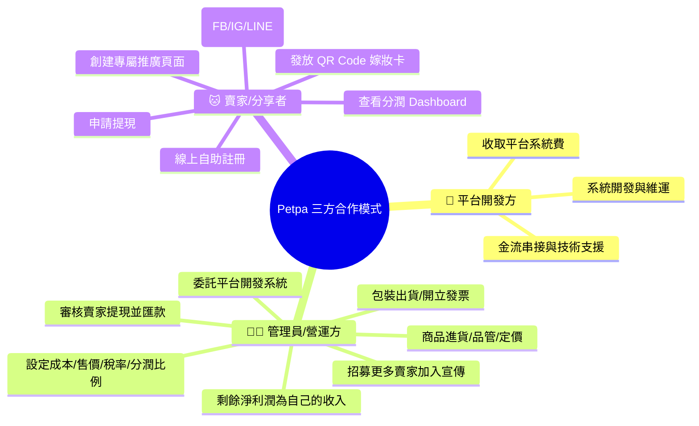

# 📋 Petpa 寵物補給站 - 商業邏輯與營運規範手冊 (Business Rules & Operations)

本文檔詳細規範 Petpa 平台之三方合作盈利模型、管理員淨利潤計算邏輯、賣家分潤規則、稅務估算機制、社群行銷工具規範，以及各方權責劃分。

---

## 💰 1. 三方合作盈利模型 (Three-Party Profit Model)

### 1.1 角色定義與盈利邏輯

| 角色 | 身份說明 | 職責 | 盈利方式 |
|---|---|---|---|
| **🏢 平台 (Platform)** | 系統開發與維護方 | 開發系統、維護伺服器、提供金流與技術支援 | 從每筆訂單淨利潤中收取固定比例**平台系統費** |
| **👨‍💼 管理員 (Operator)** | 委託平台開發系統的實際經營者 | 招募賣家加入、進貨採購、品管、包裝出貨、開立發票 | 淨利潤扣除平台費與賣家分潤後，**剩餘全部歸管理員** |
| **🐱 賣家 (Seller)** | 合作貓舍、寵物社群推廣者 | 註冊創建專屬推廣頁面、發放 QR Code、社群宣傳導流 | 從每筆導流訂單淨利潤中收取**賣家推廣分潤** |

### 1.2 淨利潤計算公式

$$\text{淨利潤 (Net Profit)} = \text{售價} - \text{進貨成本} - \text{估算稅金}$$

$$\text{平台系統費} = \text{淨利潤} \times \text{平台費率 (\%)}$$

$$\text{賣家分潤} = \text{淨利潤} \times \text{賣家分潤率 (\%)}$$

$$\boxed{\text{管理員實際利潤} = \text{淨利潤} - \text{平台系統費} - \text{賣家分潤}}$$

### 1.3 分潤比例設定規範
- **最小調整單位**：**0.5%**（可設定 5.0%、5.5%、6.0%⋯等精細粒度）。
- **管理員利潤不需要設定**：管理員利潤 = 100% - 平台費率 - 賣家分潤率，系統自動計算剩餘。
- 管理員於後台僅需設定兩個數值：**平台系統費率** 與 **賣家分潤率**。

### 1.4 系統利潤總覽試算表（管理員後台即時顯示）

以一件商品為例：售價 NT$ 500、進貨成本 NT$ 200、稅率 5%

| 項目 | 金額 | 占淨利潤比例 |
|---|---|---|
| 售價 | NT$ 500 | — |
| ➖ 進貨成本 | NT$ 200 | — |
| ➖ 估算稅金 (5%) | NT$ 25 | — |
| **淨利潤** | **NT$ 275** | **100%** |
| 🏢 平台系統費 | NT$ 27.5 | 10.0% |
| 🐱 賣家推廣分潤 | NT$ 41.25 | 15.0% |
| 👨‍💼 **管理員實際利潤** | **NT$ 206.25** | **75.0% (自動剩餘)** |

---

## 📊 2. 稅務估算機制 (Tax Estimation)

> ⚠️ **重要聲明**：系統中所有稅務相關數字均為**估算參考值 (Estimated)**，旨在協助管理員快速評估商品定價與利潤空間。**實際稅務申報與繳稅義務請依據當地稅法規定，並諮詢專業會計師辦理。**

### 2.1 稅率設定
- 管理員可於上架商品時設定該品項之**估算稅率**（預設 **5%** 營業稅）。
- 系統根據**售價 × 稅率**自動估算稅金金額。
- 所有報表與 Dashboard 中的稅金欄位均標示「*(估算)*」字樣。

### 2.2 管理員後台稅務報表顯示
- **單品利潤卡**：顯示售價、成本、*估算稅金*、淨利潤。
- **月報表**：彙總全月銷售額、總*估算稅金*、總淨利潤（方便管理員提供給會計師參考）。

---

## 🔐 3. 統一登入與三方權限架構 (Unified Auth & Role Discovery)

1. **單一入口自動判斷身份**：
   - 使用者存取 `/login` 統一登入介面，輸入 Email / 帳號後，系統依帳號特徵與註冊資料自動分流：
     - **👨‍💼 平台管理員 (Admin)**：導向 `/admin/dashboard`，擁有全站賣家審批、商品底價、總倉發貨物流與雙重審核權限。
     - **🐱 合作賣家 (Seller)**：導向 `/seller/dashboard`，擁有專屬賣場一頁式配置、分潤報表、特殊批發價提報與退貨審核權限。新賣家若無帳號可線上向管理員提出「申請入駐」。
     - **🛍️ 消費者/買家 (Buyer)**：辦理好會員（或一鍵註冊）後，自動授權登入，可自由於各大賣場下單購買與追蹤訂單物流。
2. **未登入訪客模式 (Guest Mode)**：
   - 允許訪客自由瀏覽任何賣家專屬一頁式頁面（觀看 PETLIVE 直播、幼貓血統證、影片廣告、商品目錄），但實際下單需完成買家登入或註冊會員。

---

## 🚚 4. 管理員物流控制與履約生命週期 (Logistics Management)

- **出貨方權責**：管理員為實體商品之總倉採購與履約出貨方。
- **物流生命週期狀態**：
  1. `待出貨 (PendingShipment / Paid)`：買家付款成功，總倉理貨中。
  2. `運送中 / 路上 (InTransit)`：管理員點擊「安排出貨」，產生宅配單號（黑貓宅急便/新竹物流），商品正式出庫在路上。
  3. `已送達 / 到貨 (Delivered)`：物流宅配抵達買家指定地址。
  4. `已完成 (Completed)`：買家驗收完畢，無退貨爭議，結算賣家推廣分潤。

---

## 🔄 5. 消費者退貨雙重審核制度 (Dual-Approval Return Workflow)

- **核心原則**：**平台管理員與賣家雙方都要同意 (Dual Approval Required)**。
- **流程細節**：
  1. **買家發起退貨**：買家於訂單發起售後退貨，狀態進入 `雙方審核中 (PendingDualReview)`。
  2. **雙向即時通知**：系統同時推播通知「合作賣家」與「平台管理員」。
  3. **賣家審核**：賣家在控制台確認退貨原因（瑕疵、改意等），決定「同意」或「駁回」。
  4. **平台審核**：管理員在後台確認合約規範與倉儲驗退標準，決定「同意」或「駁回」。
  5. **結案標準**：唯有 `賣家已同意` 且 `平台已同意` 時，狀態正式轉為 `Approved (雙方均同意)`，系統安排逆物流收件並自動將良品庫存回補至 ERP，隨後撥款退款。若任一方駁回，退貨案不成立並通知買家協調。

---

## 🗂️ 3. 自定義動態商品分類規範

1. **基本預設分類**：
   - 🍚 **飼料**：幼貓與成貓鮮採小包裝糧、主糧。
   - 🧼 **清潔**：寵物洗劑、除臭噴霧、環境清潔用品。
   - 💊 **保健品**：排毛粉、益生菌、魚油、維他命等。
   - 🏖️ **貓砂**：豆腐砂、礦砂、木屑砂。
2. **管理員動態擴充**：可隨時新增/編輯/排序/停用分類（如凍乾零食、主食罐頭、貓抓板玩具），前台即時同步。

---

## 🧮 4. 4 大預設賣家分潤模式 (Preset Seller Commission Models)

> 以下「分潤」指賣家從淨利潤中抽取之比例。平台系統費獨立設定。

### 模式 1: 固定百分比 (Fixed %)
- 全站所有商品統一賣家分潤率（如 **15.0%**）。

### 模式 2: 按商品分類差異 (Category-Based)
- 💊 保健品：賣家 **20.0%** | 🧼 清潔：**15.0%** | 🍚 飼料：**12.0%** | 🏖️ 貓砂：**8.0%**

### 模式 3: 階梯累計獎勵 (Tiered Volume)
- 月導流 ≤ $50,000：賣家 **10.0%**
- 月導流 $50,001~$100,000：賣家 **15.0%**
- 月導流 > $100,000：賣家 **20.0%**
- 控制台顯示進度條：「再導流 $6,500 即可升級至 15% 分潤！」

### 模式 4: 新客首單高額 (First-Time Bounty)
- 新家長首次下單：賣家 **20.0%** | 後續回購：**10.0%**

---

## 📱 5. 社群行銷快速製圖工具 (Social Media Quick-Create)

管理員後台內建一鍵社群圖片快速製作工具：

### 5.1 支援圖片尺寸

| 平台 | 用途 | 尺寸 (px) | 長寬比 |
|---|---|---|---|
| **Facebook** | 動態貼文 | **1200 × 630** | 1.91:1 |
| **Facebook** | 限時動態 | **1080 × 1920** | 9:16 |
| **Facebook** | 封面照片 | **820 × 312** | ~2.63:1 |
| **Instagram** | 方形貼文 | **1080 × 1080** | 1:1 |
| **Instagram** | 直式貼文 | **1080 × 1350** | 4:5 |
| **Instagram** | 限時動態/Reels | **1080 × 1920** | 9:16 |
| **LINE** | 圖文訊息 | **1040 × 1040** | 1:1 |

### 5.2 製圖功能
- **商品行銷圖**：選擇商品 ➔ 選擇模板與尺寸 ➔ 自動帶入商品圖/標題/價格 ➔ 一鍵下載。
- **貓舍合作宣傳圖**：帶入貓舍 Logo + 專屬 QR Code ➔ 生成推廣圖。
- **批次匯出**：一鍵產出同一商品之 FB + IG + LINE 三種尺寸（ZIP 下載）。

---

## 🏢 6. 三方權責劃分

---

## 📊 7. 各方 Dashboard 顯示規範

### 7.1 管理員後台 (Admin Dashboard) — 完整利潤可見
- **商品管理**：每件商品即時顯示成本、售價、*估算稅金*、淨利潤、平台費、賣家分潤、**管理員實際利潤**。
- **利潤總覽報表**：全站銷售額、總*估算稅金*（方便報稅參考）、平台費支出、賣家分潤支出、**管理員累計淨收入**。
- **社群快速製圖**：一鍵產出 FB/IG/LINE 行銷圖。

### 7.2 賣家控制台 (Seller Dashboard) — 僅看到自己的分潤
- **KPI 卡片**：本月賣家淨分潤、可提領餘額、導流訂單數、回購率。
- **訂單明細**：顯示訂單號、商品名稱、售價、「我的推廣分潤」金額。
- ❌ **不顯示**：成本價、平台系統費、管理員利潤（商業機密）。

### 7.3 提現規範
- 賣家「可提領餘額」達 **NT$ 1,000 元** 即可一鍵申請提現。
- 管理員 3 個工作天內完成銀行匯款並註記交易序號。

---

## 🚦 8. Staging (測試站) 與 Production (正式站) 流程與功能差異規範

在當前 **Staging 測試站** 中，為了方便開發驗證、展示與除錯，我們設計了許多「測試捷徑」；但在未來 **正式營運站 (Production)** 上線時，以下 8 大流程與功能**絕對不能沿用**，必須轉換為嚴格的商業安全規範：

| 模組面向 | 🧪 測試站現況 (Staging - 開發除錯用) | 🚀 正式營運站規範 (Production - 上線必改) | 為什麼不能這樣？(風險與原因) |
|---|---|---|---|
| **1. 登入與身份驗證** | 提供「一鍵切換身份」按鈕（買家/賣家/管理員免打密碼直接登入），以 localStorage 儲存角色。 | 徹底移除一鍵測試切換；買家支援 LINE/Google OAuth 與手機簡訊 OTP；賣家採 Email + 雙因素認證 (2FA)；管理員獨立後台路徑並綁定 IP 白名單；改用 HttpOnly JWT Cookie。 | 避免任何人惡意偽裝成管理員或賣家，竊取營業機密或盜用分潤。 |
| **2. 金流支付機制** | 信用卡 (Visa) 與綠界設為灰色未開放；ATM 僅展示固定帳號，點擊即可模擬「已付款成功」。 | 串接真實金流 API（綠界 ECPay、藍新、3D 驗證信用卡）；ATM 必須產生「每筆訂單專屬限時 16 碼虛擬帳號」，透過銀行 Webhook 回調驗證入帳。 | 正式站必須是收到真實貨款才發貨，絕不能讓前端按一下就假裝完成付款。 |
| **3. 物流派車與貨態** | 管理員手動點擊「派車 (路上)」、「回報到貨」，手動填寫假黑貓單號。 | 串接「黑貓宅急便 B2C API / 綠界大宗物流 API」，點擊出貨時自動取得真實單號並列印「托運單標籤」；貨態由物流司機刷條碼自動 Webhook 更新。 | 避免管理員憑空填錯單號或假裝出貨，買家可直接點擊單號連到黑貓官網即時追蹤貨況。 |
| **4. 特寵幼貓活體交易** | 點開幼貓相簿牆彈窗預覽合約與血統，可直接預約或下單。 | 依台灣《動保法》規定，活體買賣不得純線上口頭承諾，必須線上簽署具法律效力之《特定寵物買賣定型化契約》（電子簽名）；定期串接農業部 API 勾稽特寵登記證，撤照立即凍結活體販售。 | 符合法規要求、釐清健康責任（七天內傳染病保障）、保障消費者與業者雙方權益。 |
| **5. 庫存鎖定與防超賣** | 讀取與扣減簡易資料庫欄位，若多人同時點選可能超賣。 | 引入 Redis 分散式鎖 (Distributed Lock) 與 MongoDB ACID 交易事務：進入付款保留庫存 15 分鐘，超時自動釋放；幼貓（獨一無二生命）強制排他性鎖定。 | 避免多名買家同時轉帳購買同一隻幼貓引發重大消費糾紛。 |
| **6. 退貨雙重審核與退款** | 賣家與管理員在網頁上各點一次同意按鈕，畫面變綠色即視為退貨成立。 | 雙重審核同意後，系統自動呼叫金流 API 自動退刷/退匯款、開立折讓單/作廢電子發票，並自動產生黑貓逆物流取件單，司機到府收件檢驗無損才真正放款。 | 確保金流、稅務發票、實體商品逆向退庫三方帳目吻合。 |
| **7. 賣家入駐與 KYC 審核** | 填寫基本資料送出，管理員一鍵審核即可開店推廣。 | 賣家必須進行實名認證 (KYC)：上傳負責人身分證、營業登記執照 (統編)、特寵字號正反面、銀行存摺封面；撥款設有 7~14 天安全保護期。 | 防範人頭帳號詐騙、洗錢或賣家收款後惡意倒閉跑路。 |
| **8. 雲端儲存與敏感資訊** | 圖片使用 Unsplash 外鏈或本地上傳；日誌包含明文手機號碼。 | 圖片與影片全部改用 AWS S3 / GCP Cloud Storage 私有儲存桶配合 CDN 與 Presigned URL；日誌與訂單畫面強制對個資進行去識別化脫敏 (如 0912-***-456)。 | 避免伺服器硬碟爆滿、防止消費者個人隱私外洩遭詐騙集團利用。 |
